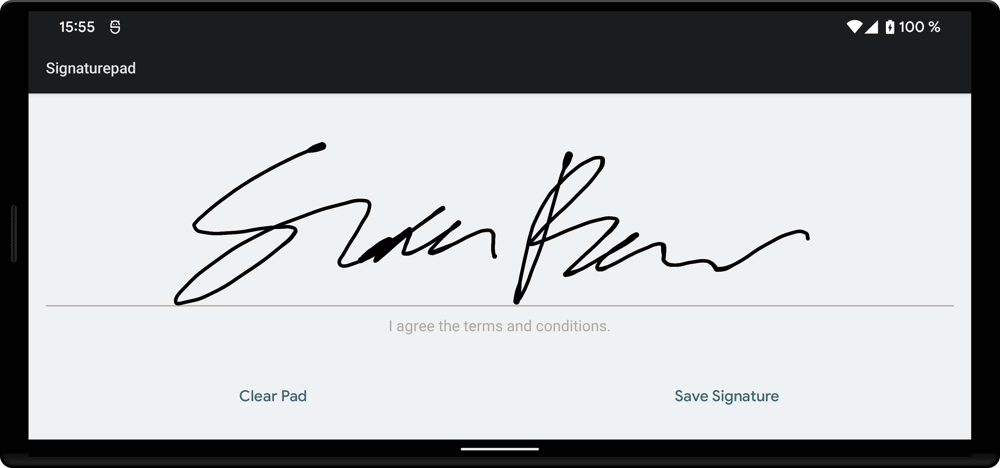

[](https://maven-badges.herokuapp.com/maven-central/se.warting.signature/signature-pad)

Android Signature Pad
====================

Android Signature Pad is an Android library for drawing smooth signatures. It uses variable width
Bézier curve interpolation based
on [Smoother Signatures](https://developer.squareup.com/blog/smoother-signatures) post
by [Square](https://squareup.com).



## Features

* Bézier implementation for a smoother line
* Variable point size based on velocity
* Customizable pen color and size
* Bitmap, SVG and raw signature data export
* Jetpack Compose state API and classic Android Views
* Undo the last stroke and restore saved signatures

## Installation

The latest published version is listed on [Maven Central](https://central.sonatype.com/artifact/se.warting.signature/signature-pad).
The library supports Android 6.0 (API 23) and newer.

### For Gradle users

Declare Maven Central in your `settings.gradle.kts`:

```kotlin
dependencyResolutionManagement {
    repositories {
        google()
        mavenCentral()
    }
}
```

Then, include the library as dependency:

```kotlin
implementation("se.warting.signature:signature-pad:<latest_version>") // Jetpack Compose
```
or
```kotlin
implementation("se.warting.signature:signature-view:<latest_version>") // Android Views
```

## Usage

*Please see the `/app` example app for a more detailed code example of how to use the
library.*

### Jetpack Compose

Hoist the signature state and give the drawing area an explicit size:

```kotlin
import androidx.compose.foundation.layout.Column
import androidx.compose.foundation.layout.Row
import androidx.compose.foundation.layout.fillMaxWidth
import androidx.compose.foundation.layout.height
import androidx.compose.material3.Button
import androidx.compose.material3.Text
import androidx.compose.runtime.Composable
import androidx.compose.ui.Modifier
import androidx.compose.ui.unit.dp
import se.warting.signaturepad.SignaturePadView
import se.warting.signaturepad.rememberSignaturePadState

@Composable
fun SignatureForm(onSave: (String) -> Unit) {
    val signatureState = rememberSignaturePadState()

    Column {
        SignaturePadView(
            state = signatureState,
            modifier = Modifier.fillMaxWidth().height(200.dp),
        )
        Row {
            Button(onClick = { signatureState.undo() }) { Text("Undo") }
            Button(onClick = { signatureState.clear() }) { Text("Clear") }
            Button(onClick = { onSave(signatureState.getSignatureSvg()) }) { Text("Save") }
        }
    }
}
```

`rememberSignaturePadState()` preserves signature events across configuration changes using
`rememberSaveable`. Use `isEmpty` and `canUndo()` to inspect the current state, and the
`onStartSigning`, `onSigning`, `onSigned`, and `onClear` callbacks to respond to input.

Existing `onReady` / `SignaturePadAdapter` integrations still work, but the adapter is deprecated.
For new code, use `SignaturePadState` as shown above.

### Android Views

```xml
<se.warting.signatureview.views.SignaturePad
    xmlns:android="http://schemas.android.com/apk/res/android"
    android:id="@+id/signature_pad"
    android:layout_width="match_parent"
    android:layout_height="200dp" />
```

Use `clear()`, `undo()`, `canUndo()`, and the export methods on the view. Register a
`SignedListener` with `setOnSignedListener()` for signing callbacks. See the sample app for
XML attributes and data binding examples.

### Configuration

* `penMinWidth` - The minimum width of the stroke (default: 3dp).
* `penMaxWidth` - The maximum width of the stroke (default: 7dp).
* `penColor` - The color of the stroke (default: Color.BLACK).
* `velocityFilterWeight` - Weight used to modify new velocity based on the previous velocity (
  default: 0.9).
* `clearOnDoubleClick` - Double click to clear pad (default: false)

### Export

Call these methods on `SignaturePadState` or the classic `SignaturePad` view:

* `getSignatureBitmap()` - A signature bitmap with a default white background. You can also customize the image's coloring e.g. `getSignatureBitmap(backgroundColor: Int, penColor: Int)`

* `getTransparentSignatureBitmap(trimBlankSpace: Boolean = false)` - A signature bitmap with a transparent background. Set `trimBlankSpace = true` to crop the bitmap to the signature bounds, removing surrounding blank space. You can also customize the image's coloring, e.g. `getTransparentSignatureBitmap(penColor: Int)`

* `getSignatureSvg()` - A signature Scalable Vector Graphics document. The default SVG stroke is black; use `getSignatureSvg(penColor, backgroundColor)` to override its colors.

Raw event persistence and standalone rendering are available with `@OptIn(ExperimentalSignatureApi::class)`:
`getSignature()` / `setSignature(signature)` save and restore events, while `Signature.toBitmap()`,
`Signature.toTransparentBitmap()`, and `Signature.toSvg()` render without a view. Import the rendering
extensions from `se.warting.signaturecore`. These APIs are experimental.

## Development

Use JDK 21 and Android SDK 36. Set `ANDROID_HOME` or `sdk.dir` in your untracked
`local.properties` file. Both ordinary Git clones and linked worktrees are supported.

```shell
./gradlew check apiCheck :app:assembleDebug
```

`check` runs unit tests, Android lint, and Detekt. Bitmap regression tests use Robolectric's
native graphics renderer; an emulator is not required. `apiCheck` verifies the published API snapshots.

The build uses AGP 9's built-in Kotlin support and new DSL. Compose and Parcelize use the same
Kotlin version as the compiler. The View library and sample app use AGP's `legacy-kapt` plugin
for data binding. API checks include both Kotlin and generated Java classes and run as part of `check`.

Release versions come from `v*` Git tags. Development versions use `git describe`, including the
commit and dirty suffix when applicable. To override the publication version, pass
`-PVERSION_NAME=0.3.0-SNAPSHOT` or set `VERSION_NAME` in `local.properties`.
